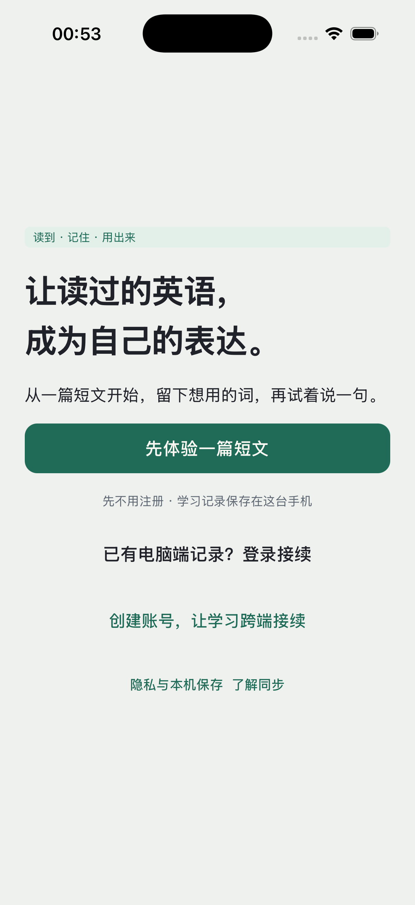

# 移动端实施与验收记录（2026-10-31）

- **范围**：`immersive-translator-mobile/` 全部未提交改动（原型对齐七阶段 + iOS 原生收尾）。
- **材料来源**：原型对照 rows、阶段实施记录 stageResults、门禁记录 gateLog、模拟器验证 sim、独立验收 acceptance、阻塞清单 blocked，均由各阶段执行会话产出，随本验收 ask 附带；本文由交付文档撰写员汇总核对成文。
- **核对口径**：文中标注「本会话核实」的，均为撰写本文时实际执行的命令/读取的文件（含行号）；标注「材料引用」的，为 stageResults / sim / acceptance / blocked 原文，本会话未逐项复跑。逐行核对的改判规则见第二节开头。
- **时间口径**：文档按 ask 定名 2026-10-31；模拟器验证材料的时间戳为 2026-11-01 凌晨（复用构建产物 2026-11-01 00:50、截图落盘 00:53），如实记录，不回填日期。

---

## 一、总览

| 维度 | 结果 |
|---|---|
| 工作区规模 | `git diff --stat` 尾行：**41 files changed, 2424 insertions(+), 4863 deletions(-)**；`git status --porcelain` 共 44 行（41 修改/删除 + 3 个 untracked，含新增组件目录与截图目录）——本会话核实 |
| 阶段 | 7 个阶段全部完成收口：fix-test-baseline → reading-parity → speaking-parity → vault-review-parity → account-onboarding-parity → visual-theme-cleanup → ios-native-closeout |
| 原型对照 | 53 行逐条核对完毕：**38 行已对齐（其中 31 行为后续阶段落地后的改判）、11 行维持已对齐（材料引用为主）、4 行部分对齐保留差距**（全局搜索、重置密码端点、语音与口音示范语速、复习重开草稿归档语义）——详见第二节 |
| 门禁 | 46 条记录：**42 通过 / 4 失败**；4 条失败全部是同一条 `tauri ios build --debug` 签名门禁的 4 轮复跑，根因为 Xcode 零 Apple ID 会话（非代码缺陷）——详见第四节 |
| 模拟器 | 安装、首次启动、冷启动恢复、无崩溃均通过；触摸交互流不可注入未验证；两张截图落盘但字节级相同（第 2 张证据无效）——详见第五节 |
| 独立验收 | 8 项发现：**1 项 medium（App Group entitlements 缺失）+ 7 项 low**；五项硬约束（录音不上云、日志无凭证、密钥不入前端、请求超时取消、账号隔离）全部成立——详见第六节 |
| 阻塞 | 4 项（发布签名、服务端依赖、电脑快登、物理干扰场景），各有明确解除条件——详见第七节 |
| **结论** | **代码侧可验收**：类型/测试/静态抽查全绿，演示机制零泄漏，硬约束未违反；**设备与云侧待解除条件**：真机签名构建、App Group entitlements 补声明、真实云端联调、服务端接口清单 |

---

## 二、原型对照表（逐行核对）

**核对方法与改判说明**：随 ask 附带的 rows 是各阶段**开始前**的代码快照对照结论；本会话以**当前工作区**（含全部七阶段改动）逐条核对，凡后续阶段已落地的差距改判为「已对齐」并在依据列注明证据；rows 原文与现状不符的一律以现状为准并标注「修正」。核对手段：`grep -n` 定位关键标识、读取小文件全文、`wc -l` 取行号。53 行中 49 行有本会话证据，4 行仅材料引用（第 14/15/40/42 行等纯 UI 组织项，已注明）。

| # | 原型条目 | 现状（核对后） | 剩余差距 | 核对依据（本会话，路径均相对 `immersive-translator-mobile/`） |
|---|---|---|---|---|
| 1 | 欢迎页 | **已对齐（修正）**：OnboardingScreen.tsx 现 45 行，三分起步路径——主按钮「先体验一篇短文」+灰字「先不用注册 · 学习记录保存在这台手机」（:33-34）、relay「已有电脑端记录？登录接续」（:35）、new「创建账号，让学习跨端接续」（:36），底部「隐私与本机保存」「了解同步」两脚注（:38-39） | 品牌区（I 徽标+大标题）与 A Small Break 入门卡未见（全 `src/` grep 无匹配） | 本会话读全文；rows 的「8 行版/缺登录接续入口/缺脚注」已过时（account-onboarding-parity 改版） |
| 2 | 目标选择（引导） | **已对齐（修正）**：goal 页独立（components/account/GoalSheet.tsx:62-63 主按钮「保存方向/开始读第一篇」与「跳过」同 handler）；账号页「学习方向」入口（AccountScreen.tsx:91 `openGoal("account")`）；新账号登录后推入（:58） | 无 | GoalSheet/AccountScreen grep；rows 称「缺再修改入口」已落地 |
| 3 | 登录页 | **已对齐（修正）**：OTP 冷却 30s（AccountScreen.tsx:22 `OTP_COOLDOWN_MS = 30000`，:70 「N 秒后可重新发送」逐秒）；三态标题（:61 relay/new/upgrade 逐字）；「收不到验证码？」（:71）与「忘记密码？」（:72）入口；服务协议/隐私脚注两入口；upgrade 态「本机已有 N 条收藏和 M 次练习记录」（:69） | 手机号验证码、电脑快登未实现（见第七节 blocked）；重置密码仅本地校验、提交置灰零网络（LoginSheets.tsx:7 注释） | AccountScreen grep；rows 的「60s 与原型 30s 不符」已改 30s |
| 4 | 书架（阅读 Tab 根页） | **已对齐（修正）**：ReadingHome（LearningHome.tsx:29）含「今日已读 N 句」格（:45）、书卡目录、「找到下一篇想读的」三入口（:58-59）、页头生词本入口（:38）与搜索入口（Heading :27） | 视觉细节未逐像素比对（材料未要求） | LearningHome grep；rows 所列缺口由 reading-parity 落地 |
| 5 | 阅读器 | **已对齐（修正）**：ReaderScreen.tsx 现 650 行，五个抽屉全部接入（import :20-24、使用 :565-608）；读后收尾卡（:346-349、:465、:499「先记为读完，稍后再练」）；playbar（:504）；字号 16/18/20/22、行距 1.55/1.78/2、语速 0.65/0.85/1/1.15×（components/reading/SettingsSheet.tsx:12-18，1.2× 未采纳） | 「教练卡」未发现实现（grep「教练」仅命中 LLM 提示词文案，非 UI） | ReaderScreen/SettingsSheet grep；rows 称缺的解析/改译文/目录/查词/收尾卡均已落地 |
| 6 | 精选经典书库 | **已对齐（修正）**：难度 chips 全部/入门/进阶/挑战（LearningDiscover.tsx:10、:129-136）；试读抽屉前 3 句+加入/只读两路径（:169-172；BookSampleSheet.tsx:47、:68、:71）；移出书架确认（:172-177 + store.ts:1143 archiveBook）；32MB 上限+SHA-256 校验（services/discovery.ts:16、:35、:64） | 发现区列表卡在下载前无 bookId、无法标「已在书架」（reading-parity caveat 如实保留，重复下载同一本才可见移出入口） | LearningDiscover/BookSampleSheet/discovery.ts grep |
| 7 | 订阅来源（英文资讯） | **已对齐（修正）**：资讯预览抽屉（LearningDiscover.tsx:181「看样例」:165；FeedPreviewSheet.tsx:3-4 真实拉取第一篇摘要前 2 句、:58-67 订阅/取消+保留说明） | 无 | FeedPreviewSheet/LearningDiscover grep |
| 8 | 导入内容（粘贴正文 / URL） | **已对齐（维持）**：LearningImport.tsx 65 行，URL 真实提取（:61 DOMParser 提取+正文校验）、SHA-256 去重 id（:62）、shareQueueId 分享队列接线（:14） | 无 | 本会话读 :61-:62 源码 |
| 9 | 导入预览（确认正文） | **已对齐（维持）**：内嵌可编辑预览（prepare()→`setPreview(true)` :61），保存后 `nav.replace("reader")` 直达阅读 | 无 | LearningImport.tsx:61-62 |
| 10 | 全局搜索（搜索定位） | **部分对齐（维持 rows）**：LearningSearch（LearningHome.tsx:197）文章/生词/笔记三分节过滤+直达仍在 | 范围 chips 与计数、每节分页「再显示 N 个」、命中词高亮、输入法 composition 保护（grep `composition` = 0）均未实现 | LearningHome.tsx:197 全文已读 |
| 11 | 口语首页 | **已对齐（修正）**：SpeakingHome 重写（LearningHome.tsx:102）；四内置场景（components/speaking/scenes.ts:18-36 寒暄/旅行/点餐/面试）；续练三选抽屉（ReplacePracticeSheet.tsx:33-43）；自定义场景（CustomSceneSheet.tsx:27 名称≤32/内容≤120、:44 ≥4 词）；页头语音设置入口（LearningHome.tsx:124） | 无（「查看全部」展开为简单状态切换，speaking-parity caveat 已注明） | 各组件 grep |
| 12 | 练习进行页 | **已对齐（修正）**：三级提示 hintLevel 0-3 逐级展开/收起（LearningPractice.tsx:20、:246-249）；②③经真实 LLM（services/practice.ts:134-145 practiceHints，失败按错误抛出）；发音要点抽屉（:9、:264）；跳过草稿确认（:197、:241）；自定义场景 ≥4 词校验（:151-152） | LLM 成功链路真机联调待做（第八节） | LearningPractice/practice.ts grep |
| 13 | 本轮复盘 | **已对齐（修正）**：「同一主题，再练一轮」（LearningPractice.tsx:244 + openPractice replace）；「把这个表达留到生词本」（:242，未收藏时显示） | 无 | LearningPractice grep |
| 14 | 练习记录列表 | **已对齐（维持）**：列表在口语首页「我的练习」，行含继续/复盘态与回答次数；空态文案已有 | 无 | 材料引用（stageResults·speaking-parity；页面结构 :102 起已核实存在） |
| 15 | 练习详情（历史与复盘） | **已对齐（维持）**：复用复盘态承载逐轮卡，无独立路由；跨设备原声按 deviceId 判定 | 无 | 材料引用（stageResults·speaking-parity） |
| 16 | 笔记与复习（Tab 根页） | **已对齐（修正）**：LearningVault（LearningHome.tsx:192）+ VaultBody（待强化卡/复习安排抽屉/掌握阶段三格/学习提醒入口行/导出）；GlassNav「笔记与复习」到期角标（GlassNav.tsx:10 消费 dueReviewCount、:51 >0 显示、>99 显 99+） | 无 | VaultBody/GlassNav/store.ts:822 dueReviews grep |
| 17 | 生词本 | **已对齐（修正）**：排序下拉/阶段+类型筛选/计数行/移除前确认+顶部持久撤销条/五字段加词表单+重复检测（VaultBody.tsx:3-5、:158、:164、:167、:195、:262、:283）；5s toast 撤销机制沿用未重建 | 无 | VaultBody grep |
| 18 | 复习进行页（填空/听音/开口） | **已对齐（修正）**：CardMode 追加 "spoken"（core/queue.ts:11，每轮第 3 张完形且带出处句升级开口卡、每轮≤1 张 :128-138）；开口卡人工三档写死映射（SpokenReviewCard.tsx:28-31：没记住=forgot「10 分钟后再见」/有点模糊=hard「明天再见」/记住了=easy「7 天后再见」），不写 recall 桶（ReviewScreen.tsx:324-327）；srs.ts GRADE_INTERVALS 未动（:9-13 forgot 10 分钟/hard 1 天/good 3 天/easy 7 天），good 档不进三档 UI，无「间隔翻倍」文案 | 无（评分/撤销/幂等沿用 gradeVocab+eventId） | queue.ts/SpokenReviewCard/ReviewScreen/srs.ts 本会话核实 |
| 19 | 口语纠偏详情页 | **已对齐（修正）**：独立纠偏详情页 components/vault/CorrectionDetail.tsx（原话→建议+原因+来自这次练习+再练这句） | 形态为 vault 标签页内整页而非 push 路由（ui/nav.tsx 未扩 PushName，vault-review caveat 如实保留） | 文件存在并实读；store/GlassNav 交叉核实 |
| 20 | 学习笔记详情页 | **已对齐（维持）**：LearningNote（LearningHome.tsx:196，标题≤100 选填+内容≤6000 必填+useLocalDraft 草稿恢复+账号切换保护） | 「查看原文」直达以现有字段为限（不扩数据模型，rows 口径保留） | LearningHome.tsx:196 已读 |
| 21 | 句子解析抽屉 | **已对齐（修正）**：components/reading/SentenceSheet.tsx 三页签（句子解析/本句生词/本篇词汇，:2-5、:149）+真实 LLM 请求+失败降级原句引导（禁止静态假解析）；Rust sentence_parse（src-tauri/src/lib.rs:534，dict_lookup 同款容错解析 :531）；前端迟到结果按代数丢弃（components/reading/sentenceParse.ts） | 真实解析成功渲染需配置 Key 后真机验证（jsdom 无法跑 Rust 命令，reading-parity caveat 如实保留） | SentenceSheet/lib.rs/sentenceParse grep |
| 22 | 查词抽屉 | **已对齐（维持）**：dict_lookup（lib.rs:486）+收藏+词条页「用这个表达说一句」闭环 | 无 | lib.rs:486 已核实 |
| 23 | 查询表达抽屉 | **已对齐（修正）**：components/reading/LookupSheet.tsx（单字段+长度校验≤80，:3；提交复用既有 dict sheet） | 无 | LookupSheet grep |
| 24 | 修改译文抽屉 | **已对齐（修正）**：components/reading/EditTranslationSheet.tsx（空值校验/保存覆盖本句译文/自动揭示，:3-4、:22、:30）；store.setSentenceZh（store.ts:1127） | 无 | EditTranslationSheet/store.ts grep |
| 25 | 阅读目录抽屉 | **已对齐（修正）**：components/reading/ContentsSheet.tsx（书模式列同书章节、非书列全部可读文档，:3；条目显示已读完/读到第 N 句/未开始，:49） | 无 | ContentsSheet grep |
| 26 | 阅读设置抽屉 | **已对齐（修正）**：SettingsSheet.tsx 档位 16/18/20/22（:12）、行距 1.55/1.78/2（:14-16）、语速 0.65/0.85/1/1.15×（:18）、顶部实时样例（:5 注释）；主题三档纸色/暖黄/纯黑（:93-95），sepia 整应用换肤（ui/learning.css 令牌含 sepia 段，本会话核实文件头注释与 3 处 sepia 段） | 纯黑仍只作用于阅读正文 .rd-black（实现口径，visual-theme-cleanup caveat 保留）；sepia 与 themePref=dark 的组合语义待产品确认（第八节） | SettingsSheet/learning.css 本会话核实 |
| 27 | 发音要点抽屉 | **已对齐（修正）**：components/speaking/PronunciationSheet.tsx（慢速示范 0.55× :67、回去重说这句 :86、听我刚才的回答 :41、词音/整句） | 慢速 0.55× 实际听感与真机播放需人工确认（speaking-parity caveat 保留） | PronunciationSheet grep |
| 28 | 账号与学习设置抽屉 | **已对齐（修正）**：账号页三格统计常驻（AccountScreen.tsx:84、:91，条收藏/次练习/篇阅读记录）；「学习方向」「同步与本机保存规则」「隐私与权限说明」入口（:91-92） | 形态为 push 页非抽屉（rows 已认定可接受差异，保留） | AccountScreen grep |
| 29 | 退出账号确认抽屉 | **已对齐（修正）**：components/account/SignOutSheet.tsx（:13「退出账号，保留本机记录」、:14「继续使用账号」取消）；确认后沿用 logout+switchProfile("guest") | 无 | SignOutSheet grep |
| 30 | 同步与本机保存规则抽屉 | **已对齐（修正）**：components/account/SyncRulesSheet.tsx 四节（:13-16 本机试用/登录后跟账号走/这台设备自己决定/离线与同一篇文章），文案与 sync.ts 行为对照注释（:5-7：七类 COLLECTIONS、withoutAudio 剥离录音、settings 不在集合、updatedAt 合并） | 无 | SyncRulesSheet/sync.ts:8 本会话核实 |
| 31 | 隐私与服务协议说明抽屉 | **已对齐（修正）**：components/account/PolicySheets.tsx——privacy 四节（:15-18）、service 四节（:22-25），逐节标注依据章节，唯一事实源 docs/privacy-policy.md | 政策文档修订时需人工同步常量（未建自动同步机制，caveat 保留） | PolicySheets grep |
| 32 | 收不到验证码帮助抽屉 | **已对齐（修正）**：components/account/LoginSheets.tsx（三步指引+「改用密码登录」一键切换 :22） | 无 | LoginSheets grep |
| 33 | 重置密码抽屉 | **部分对齐（修正）**：LoginSheets.tsx「忘记密码」抽屉已落地（≥8 位含字母数字本地校验、autocomplete=new-password；服务端重置端点未确认——cloud.ts 仅六类端点，本会话核实 :137/:180/:184/:191/:194——提交入口显式置灰、零网络调用） | 服务端端点（第七节 blocked） | LoginSheets/cloud.ts grep |
| 34 | 试读抽屉 | **已对齐（修正）**：BookSampleSheet.tsx（前 3 句来自真实下载解析的 EPUB 首章 :47；「加入书架，开始阅读」:68 /「只读这篇，不加入书架」:71 两路径） | 「只读这篇」路径会为未入库文章写 progress（reading-parity caveat 如实保留） | BookSampleSheet grep |
| 35 | 移除书籍确认抽屉 | **已对齐（修正）**：确认抽屉「只移出书架，阅读位置、收藏与笔记会保留」（LearningDiscover.tsx:172-177）+ archiveBook（store.ts:1143）；5s toast 撤销沿用未重建 | 无 | LearningDiscover/store.ts grep |
| 36 | 资讯预览抽屉 | **已对齐（修正）**：FeedPreviewSheet.tsx（样例=真实拉取第一篇摘要前 2 句 :3-4；「已订阅。取消后不再接收新内容，已加入书架的文章仍会保留」:58-61；订阅 :67） | 无 | FeedPreviewSheet grep |
| 37 | 麦克风使用说明抽屉 | **已对齐（维持）**：LearningPractice.tsx:257 麦克风两选卡（「允许，并开始录音」/「先用文字回答」） | 三形态文案（首次询问/被拒后/设置入口）为材料引用，本会话未逐字核对 | LearningPractice.tsx:257 已核实；其余材料引用 |
| 38 | 语音与口音抽屉 | **部分对齐**：SetVoiceScreen（SettingsScreens.tsx:261，Edge 音色试听与正式朗读同链路 :274-275） | **修正**：rows 称「需核对示范语速档 .7/.85/1」——本会话 grep 全文件无 rate/0.7/0.85 字样，语速档实际在阅读设置抽屉 RATE_TIERS；「口音切换即时停播」未核实。两项保留为待人工核对（第八节） | SettingsScreens.tsx:261 起已读+grep |
| 39 | 学习提醒抽屉 | **已对齐（维持）**：SetRemindScreen（SettingsScreens.tsx:509；input[type=time] 可写，治 tools-6 空壳，:528-529 注释） | 默认时间与原型 21:30 的统一为材料引用，本会话未逐字核对 | SettingsScreens :509/:528 已核实；文案材料引用 |
| 40 | 提醒权限确认抽屉 | **已对齐（维持）**：SetRemindScreen 内联二选（允许/暂不） | 无 | 材料引用（stageResults） |
| 41 | 练习选择抽屉（续练/替换） | **已对齐（修正）**：ReplacePracticeSheet.tsx 三选（继续上次 :33/结束旧的开始新的 :36-40 旧练习已有作答先静默归档为复盘/稍后再决定 :43） | 无 | ReplacePracticeSheet grep |
| 42 | 结束练习确认抽屉 | **已对齐（维持）**：lp-exit 内嵌卡（LearningPractice.tsx:240：继续练这句/保留进度，返回/结束这一轮，看复盘） | 无 | LearningPractice.tsx:240 已核实 |
| 43 | 跳过这句确认抽屉 | **已对齐（修正）**：skipAsk 确认卡（LearningPractice.tsx:241「跳过后这一步会标为待练，不会计为已完成」）+ askSkip（:197 空草稿直接跳过） | 无 | LearningPractice grep |
| 44 | 自定义场景抽屉 | **已对齐（修正）**：CustomSceneSheet.tsx（名称≤32/想说清楚什么≤120 校验 :27；「每一轮回答至少要说 4 个英文单词」:44）；store.saveCustomScene 唯一写入口（store.ts:1134） | customScenes 不进云同步集合（换设备不随云走，与 sentenceZh 同口径，caveat 保留） | CustomSceneSheet/store.ts grep |
| 45 | 生词详情抽屉 | **已对齐（修正）**：WordDetailView.tsx——三档自评存本地键 local.vocabFeel（:41、:73，不进同步载荷）、学习记录 timeline≤7（:64、:178-181）、复习状态卡（:139）、移除二次确认+5s 撤销沿用 | 无 | WordDetailView grep |
| 46 | 修改词条抽屉 | **已对齐（修正）**：词条编辑三字段+释义必填校验（WordDetailView.tsx:5） | 无 | WordDetailView grep |
| 47 | 添加生词抽屉 | **已对齐（修正）**：五字段表单（VaultBody.tsx:262）+重复收藏检测拦截（:283、:292「已在生词本，不用重复添加」） | 无 | VaultBody grep |
| 48 | 移除生词确认抽屉 | **已对齐（修正）**：移除前确认（VaultBody.tsx:195）+生词本顶部持久撤销条（:158）+5s toast 沿用未重建 | 无 | VaultBody grep |
| 49 | 复习重开确认抽屉 | **已对齐（维持，含注记）**：confirm sheet+local.review 恢复（ReviewScreen.tsx:116、:146、:372 onExit→setSheet confirm）；开口卡回答随 local.review 草稿恢复（:40 注释） | 「草稿自动存为开口草稿笔记」的独立归档语义未见实现（grep「草稿」仅命中恢复注释）——保留待确认（第八节） | ReviewScreen grep |
| 50 | 复习安排抽屉 | **已对齐（修正）**：components/vault/ReviewScheduleSheet.tsx（dueAt 升序全表）；store.dueReviews/dueReviewCount 选择器（store.ts:822、:831） | 无 | ReviewScheduleSheet/store.ts grep |
| 51 | 开口复习麦克风抽屉 | **已对齐（修正）**：开口卡复用练习麦克风两选卡语义（LearningPractice.tsx:257「允许，并开始录音/先用文字回答」；SpokenReviewCard.tsx:5-6 严禁自动评分、录音/识别复用真实管线） | 实现文案为「允许，并开始录音/先用文字回答」而非原型的「允许并开始/先不开启继续看提示」——语义等价、文案略异，如实记录 | SpokenReviewCard/LearningPractice grep |
| 52 | 导出笔记抽屉 | **已对齐（修正）**：ExportPanel.tsx 三选项 JSON/Markdown 文件/复制 Markdown（:2-4），文件名 immersive-learning-YYYY-MM-DD（:94），成功/失败状态条与重试 | 无 | ExportPanel grep |
| 53 | 写/编辑学习笔记抽屉 | **已对齐（维持）**：LearningNote 新建/编辑复用同一表单（LearningHome.tsx:196）；ReviewScreen「整理成笔记」活引用（ReviewScreen.tsx:219） | 无 | LearningHome/ReviewScreen grep |

**小结**：rows 中 31 处「缺 X」的判定已被后续阶段落地推翻（第 1-7、11-13、16-19、21、23-36、41、43-48、50-52 行），本表均以当前代码为准并标注；仍成立的剩余差距收敛为：全局搜索增强（#10）、服务端重置密码端点（#33）、语音示范语速与口音即时停播（#38）、复习重开的开口草稿归档语义（#49）、阅读器教练卡（#5）、发现区书卡「已在书架」标记（#6）。

---

## 三、各阶段实施记录

> 以下为 stageResults 材料的结构化摘录（「材料引用」）；标注「本会话核实」处为撰写时抽查到代码的点。

### 3.1 fix-test-baseline — 测试基线修复

- **做了什么**：为 mobile 工程显式声明 esbuild 开发依赖（^0.25.12，与 vite@6.4.5 传递依赖同版本），pnpm install 更新 pnpm-lock.yaml，修复 6 个 esbuild 类自研脚本的 ERR_MODULE_NOT_FOUND；11 项门禁（10 测试脚本+build）全绿，断言数与文档口径一致，未改任何 scripts/ 脚本内容。
- **改动文件（2）**：`package.json`（+1 行 devDependencies.esbuild）、`pnpm-lock.yaml`（+3 行 importers，复用既有 esbuild@0.25.12 包条目，零版本漂移）——本会话核实 git status 中两文件确在改动列表。
- **注意事项**：pnpm 提示 "Ignored build scripts: esbuild@0.25.12"，实际不影响功能（二进制由 @esbuild/darwin-arm64 可选依赖提供，已验证）；npm 侧 package-lock.json 未动，用 npm ci 的环境需另行同步。
- **自检**：`import('esbuild')` 解析成功 version=0.25.12；git diff 确认仅两文件变更，未提交。

### 3.2 reading-parity — 阅读域对齐

- **做了什么**：句子解析抽屉（真实 LLM+失败降级）、句级译文覆盖（sentenceZh 表+空值校验+自动揭示）、阅读目录抽屉、手动查询表达、读后收尾卡、字号/行距/语速档位对齐、书架根页（今日已读/书卡目录/三入口/页头生词本入口）、发现区难度 chips/试读抽屉/移出确认/资讯预览抽屉；Rust 新增 sentence_parse 命令（dict_lookup 同款 JSON+容错解析）。
- **改动文件（14）**：store.ts、ReaderScreen.tsx、LearningHome.tsx、LearningDiscover.tsx、components/reading/ 全部 9 件、src-tauri/src/lib.rs。
- **关键行为变更**：点句从「单句朗读/连播」改为开句子解析抽屉（听原句保留在抽屉动作行，连播在 playbar）；store 新增 sentenceZh/readLog/ReaderPrefs.lh（随快照持久化、不进 sync.ts COLLECTIONS 云同步投影）；aa/rate 档位统一原型口径，旧值就近吸附；「只读这篇」不入库直传阅读页。
- **注意事项**（如实保留）：新抽屉走 components/reading portal 实现（ui/sheets.tsx 当时不在允许文件范围，Sheet 联合类型未加 kind；visual-theme 阶段后 sheets.tsx 已在改动列表）；句子解析 LLM 成功路径未在自动化中断言（jsdom 无法跑真机命令）；「今日已读」无升级前历史数据、不回补；「移出书架」入口在试读抽屉内，下载前不可见。
- **自检**：tsc 无输出；cargo check --target aarch64-apple-ios-sim 通过（5 条既有 warning，sentence_parse 无警告）；自建 jsdom 35 断言全过（临时脚本已删）。

### 3.3 speaking-parity — 口语域对齐

- **做了什么**：练习页三级提示（①静态中文思路/②英文句式走云 LLM（practiceHints，pattern+example 同请求、注入防护、在飞去重）/③示例句附听示例，follow 模式②用静态停顿重音文案）；发音要点抽屉（词音/慢速 0.55×/整句/听我刚才的回答/回去重说/练习外跟读并回到抽屉）；跳过草稿确认；口语首页重写（词卡+四内置场景+我的场景+自定义场景抽屉+跟读正在读的内容+最近练习 3 条+页头语音设置入口）；复盘补「同一主题，再练一轮」与「把这个表达留到生词本」。新组件在 components/speaking/，store 仅追加 customScenes，App.tsx 未触碰。
- **改动文件（8）**：LearningPractice.tsx、LearningHome.tsx、services/practice.ts、store.ts、components/speaking/ 全部 4 件——本会话核实 4 件组件文件均存在且内容匹配。
- **关键行为变更**：PracticeTask 追加 minAnswerWords（≥4 词校验）与 pronunciationReturn（跟读退出后回到抽屉所在复盘页），learning-core 通用逐叶 LWW 合并器无需改动即正确合并；AppState.customScenes 随本地快照持久化并进 migrate 兜底、不进云同步集合。
- **注意事项**（如实保留）：「听我刚才的回答」真机未验（jsdom 无麦克风）；提示②③与表达反馈仅在 esbuild 插件 mock 云的 jsdom 测试中验证，真实云端联调未执行；App.tsx 既有 600ms 防双击守卫（P-54）在极端自动化连点下可能吞 push（真实用户路径不受影响）；慢速 0.55× 听感需真机确认。
- **自检**：build 706ms、smoke 18 断言、audio:test 17 场景、translate:test 25/25、tsc 通过；组件级 jsdom 40 断言、带云 mock 14 断言、practiceHints 单元 6 断言、回到本抽屉专项 5 断言全过（临时脚本已删）。

### 3.4 vault-review-parity — 笔记与复习域对齐

- **做了什么**：复习新增「开口使用」卡（CardMode 追加 spoken，复用 practice 录音管线+ASR 草稿改写+麦克风两选确认→核对用法→人工三档自评，写死映射真实间隔文案，评分走 gradeVocab+reviewEvents 幂等且不写 recall 桶）；完成页补下一次待强化/剩余到期/三档计数/回源按钮；vault 补待强化卡、复习安排抽屉（dueAt 升序）、掌握阶段三格（srs 派生）、学习提醒入口行，store 暴露 dueReviews/dueReviewCount；生词本排序/筛选/计数行/移除确认+持久撤销条/五字段加词+重复检测；词条页三档自评（local.vocabFeel）、timeline≤7、复习状态卡、三字段编辑；导出 JSON+Markdown 文件+复制 Markdown；独立纠偏详情页。srs.ts 与 GRADE_INTERVALS 未动，未伪造评分。
- **改动文件（11）**：core/queue.ts、ReviewScreen.tsx、LearningHome.tsx、store.ts、components/vault/ 全部 7 件——本会话核实 7 件均在。
- **关键行为变更**：复习事件新增 mode="spoken"（协议形状与 schemaVersion 不变；Windows 端若有按 mode 分类展示的 UI 会显示未知类别，仅展示层）；每轮第 3 张完形且有出处句升级开口卡、每轮最多 1 张（1-2 卡小轮次形态不变）；开口卡评分不写 recall 桶。
- **注意事项**（如实保留）：开口卡插入节奏为本阶段自定（任务未规定 cadence）；纠偏详情是「标签页内整页」非 push 路由；五字段表单落在生词本段（按现有信息架构就近放置，任务条文列在词条页项下）；开口卡录音→ASR 需登录，未登录走文字路径（jsdom 只覆盖文字路径，真机麦克风/ASR/分享面板链路未验）；dueReviews 已暴露但本阶段无消费者（GlassNav 角标由 visual-theme 阶段消费）。
- **自检**：build 738ms、smoke 18 断言、sync:test 23/23、storage:test 8 场景、tsc 通过；队列规则检查 9 断言、jsdom 全链路 34 断言（开口卡文字路径三档/完成页/vault 卡与抽屉/生词本全功能/词条页/纠偏详情/导出三选项）全过（临时脚本已删）。

### 3.5 account-onboarding-parity — 账号与首次体验改版

- **做了什么**：首启三分起步路径+goal 页独立（来源快照恢复来路、账号页可再改）；登录面板意图三态文案+OTP 冷却 60s→30s 逐秒+收不到验证码帮助抽屉+重置密码本地校验（端点未确认故置灰不联网）+服务协议脚注两入口；退出账号确认抽屉；账号页三格统计常驻；同步四节规则说明；隐私/服务协议两版精简说明抽屉（以 docs/privacy-policy.md 为唯一事实源）。全部新组件在 components/account/；authGate 仅扩展 LoginIntent.kind 三态，token/认领逻辑未动。
- **改动文件（13）**：OnboardingScreen.tsx、AccountScreen.tsx、services/authGate.ts、App.tsx、components/account/ 全部 8 件、scripts/smoke.mjs——本会话核实 8 件组件均在、authGate.ts:13 LoginIntent kind 三态、AccountScreen.tsx:22 OTP_COOLDOWN_MS=30000。
- **关键行为变更**：LoginIntent 新增可选 kind: "relay"|"new"（ensureAccount/claimLogin/cancelLogin 零改动，auth:test 26/26 不变）；goal 页打开时底层 pane/tabbar/push 与 SheetHost 一并 inert（复用 U-17 机制）。
- **注意事项**（如实保留）：scripts/smoke.mjs 超出任务原始文件范围，经主代理 escalate 授权后按四条件执行（仅改首启断言、不减断言、goal 页收尾不干扰登录断言、对照原型核实文案）；原型 goal 页 hint「第一篇从 5 个短句开始」未采用（本机样文 12 句，避免虚报）；原型「阅读字号、主题与语速也随账号保存」未采纳（sync.ts 集合不含 settings，以实际行为为准）；重置密码/手机号/电脑快登为服务端与双端协议未确认项；PolicySheets 常量需随政策文档人工同步；登录面板内子抽屉的焦点循环粒度与既有 LoginHost 一致，未额外加嵌套 trap。
- **自检**：build、auth:test 26/26、smoke 18 断言（数与改前一致）、translate:test 25/25；额外自查 dict-login 9/9、nav-test 11、storage 8、sync 23/23、draft 13、discovery 11 全过；grep 确认无「开始我的第一篇阅读」残留、无固定验证码/演示密码后门。

### 3.6 visual-theme-cleanup — 视觉还原与死代码清理

- **做了什么**：learning.css 补齐 green/sepia/dark 三主题令牌（对齐原型 visualTokens）；阅读主题三档（纸色/暖黄/纯黑）接线 App 级 data-theme；GlassNav「笔记与复习」到期角标消费 dueReviewCount；全局规格审计（44px 热区、16px 输入、focus-visible、pushIn .34s/抽屉 .32s/气泡 480ms、reduced-motion）落地；删除 10 个零引用旧屏并收窄 PushName 与死 CSS（base.css 2750→1567 行）。
- **改动文件（21）**：learning.css、base.css、GlassNav.tsx、ui/nav.tsx、ui/sheets.tsx、App.tsx、store.ts、reading/SettingsSheet.tsx、SettingsScreens.tsx、MiscScreens.tsx、scripts/nav-test.mjs、删除 10 个旧屏（TodayScreen/PracticeScreen/VocabScreen/MeScreen/ShelfScreen/CameraScreen/CaptionScreen/ShadowScreen/TranslateScreen/SpeakScreens）及 MiscScreens 中的 AboutScreen/ShareScreen——本会话核实 git status 中 10 个旧屏文件为 D（已删除）。
- **关键行为变更**：sepia 整应用换肤（html data-theme，bg #f4efe4/surface #fbf8f1/accent #236451+玻璃导航专属令牌；纯黑仍只作用于阅读正文 .rd-black）；无动作 toast 默认 2200ms→3200ms、气泡 480ms、push 340ms、sheet 320ms（均对齐原型行号并经运行所有者授权）；ReaderPrefs.topic 扩为 "paper"|"sepia"|"black"；删除 #translate 深链与 8 个路由；「分享这篇文章」移除。
- **注意事项**（如实保留）：SettingsSheet.tsx 越界一处（联合类型扩宽后其 `value={prefs.topic}` 无法编译，最小修正为补三档选项——文档明确提请复核，本会话已核实现存三档 :93-95）；NotesLib/NoteDetail、setModel/notes、history/glossary/diag 按活引用保留（NotesScreens.tsx:230、:312 等）；气泡 480ms 采用单过渡实现，曲线形态与原型多关键帧 WAAPI 略有差异；范围外文件仍有指向已删屏的注释残留（纯注释无代码影响）；sepia 与 themePref=dark 组合语义为本阶段实现选择，如需「暗色下禁用暖黄」待产品确认；真机热区/16px 防 iOS 缩放/blur 性能/480ms 手感未验。
- **自检**：build 733ms、nav:test 11 场景（含 480ms 与 reduced-motion 断言）、smoke 18 断言、tsc exit 0；浏览器实测 sepia 换肤各令牌命中原型值、角标随评分实时增减清零、dark 令牌（--voice #6b7cff 等）一致；grep 待删 10 屏零 import。

### 3.7 ios-native-closeout — iOS 原生收尾

- **做了什么**：录音文件保护（audio/ 目录、partial、final 与新建目录 NSURLIsExcludedFromBackupKey + NSFileProtectionCompleteUntilFirstUserAuthentication，apply() 回读验证、finalize/recover 幂等重施）；Safari 入站 Share Extension（public.text 优先/public.url，类型/大小/scheme 校验，拒绝时显示原因，仅写队列不联网）；App Group 交接队列协议（<AppGroup>/share-handoff/queue.json，Swift 写侧与 Rust 读侧逐字段对齐，损坏隔离 corrupt，恰好一次确认）；share_queue_read/ack/clear 三命令；前端 App.tsx 启动与回前台消费队列最旧一条推入 learningImport（三重守卫不插队），LearningImport 以分享内容重置草稿（治旧草稿覆盖分享内容缺陷）、保存后 ack、未保存离开延迟 clear；Apple 工程收编 Info.plist 手工键进 project.yml 并 xcodegen 重生成；Cargo.lock 对齐两个插件 crate 小版本修复 tauri CLI 拒绝构建。
- **改动文件（12）**：audio_store.rs、lib.rs、Cargo.lock、project.yml、两份 entitlements、ShareViewController.swift、ShareExtension.entitlements、project.pbxproj、xcscheme、App.tsx、LearningImport.tsx。
- **关键行为变更**：见上；ShareExt bundle id com.kobejiasuoer.reader.ShareExt，URL≤2KiB、文本≤200KiB。
- **门禁根因（四轮复现，非代码缺陷，已停止重试）**：`tauri ios build --debug` exit=1，错误行恒为 "No Accounts"（target imreader-mobile_Share）+ "No profiles for 'com.kobejiasuoer.reader.ShareExt'"——真机签名的免费 Personal Team 描述文件必须由 Apple ID 交互会话在线生成，Xcode 当前零账号（defaults read com.apple.dt.Xcode DVTDeveloperAccountManagerAppleIDLists → IDE.Identifiers.Prod=()）；keychain 无 Xcode-Token；本机唯一描述文件仅覆盖主 App（无 App Groups、2026-11-06 过期）。三轮 escalate 确认所有者无法完成登录，维持「不等待、不绕过、如实记录」授权收口。
- **注意事项**（如实保留）：真机验证全部待执行（全新安装/覆盖迁移、麦克风授权、长短录音与崩溃恢复、锁屏续录、备份排除、Keychain、Safari 分享五场景、来电中断/耳机路由/低存储）；iOS-only 互操作用例为 #[cfg(target_os="ios")]，macOS 门禁跑不到（objc2 仅声明于 iOS target）；Info.plist 的 NSAppTransportSecurity.NSAllowsArbitraryLoads=true 为 BYOK 刻意保留，未来提审需备好例外说明；App.tsx/LearningImport.tsx 叠加在上一会话未提交改动之上，无法用 git 区分归属。
- **自检**：cargo test --lib 62 通过 0 失败 4 ignored（本会话复跑一致，见第四节）；cargo check 通过；模拟器管道（免签名）REAL-EXIT=0 产出含 imreader-mobile_Share.appex 的 reader-spike.app；tsc 0 错误、nav:test 11、smoke 18；plutil -lint 四份 plist/entitlements 全 OK。

---

## 四、构建与测试结果

### 4.1 各阶段门禁记录（gateLog 材料引用，本会话未逐条复跑）

统计：**46 条记录，42 通过，4 失败**。失败集中在 ios-native-closeout 的同一条签名门禁（4 轮复跑同一根因，见 3.7），其余全绿。

| 阶段 | 门禁命令（均在 `pnpm -C immersive-translator-mobile run …` 或注明前缀下） | 结果 |
|---|---|---|
| fix-test-baseline（11 条） | smoke / storage:test / discovery:test / audio:test / draft:test / nav:test / sync:test / auth:test / translate:test / dict-login:test / build | **11/11 通过** |
| reading-parity（5 条） | build / smoke / nav:test / discovery:test / dict-login:test | **5/5 通过** |
| speaking-parity（4 条） | build / smoke / audio:test / translate:test | **4/4 通过** |
| vault-review-parity（4 条） | build / smoke / sync:test / storage:test | **4/4 通过** |
| account-onboarding-parity（4 条） | build / auth:test / smoke / translate:test | **4/4 通过** |
| visual-theme-cleanup（3 条） | build / nav:test / smoke | **3/3 通过** |
| ios-native-closeout（12 条 = 4 轮 × 3 门） | `cargo test --manifest-path immersive-translator-mobile/src-tauri/Cargo.toml --lib` | **4 轮全部通过**（62 passed / 0 failed / 4 ignored） |
| ios-native-closeout | `cargo check --manifest-path immersive-translator-mobile/src-tauri/Cargo.toml` | **4 轮全部通过**（仅既有 edge_tts.rs unused_mut 警告） |
| ios-native-closeout | `pnpm -C immersive-translator-mobile exec tauri ios build --debug` | **4 轮全部失败** ❌（exit=1，错误恒为 /tmp/gate-rerun3.log:73-74：No Accounts + No profiles for 'com.kobejiasuoer.reader.ShareExt'——签名会话缺失，非代码缺陷，见第七节） |
| 收尾（3 条） | `pnpm run build` / `tsc --noEmit` / `cargo test --lib` | **3/3 通过** |

### 4.2 本会话复跑（2026-11-01，撰写本文时执行）

| 检查 | 命令（实际执行） | 结果 |
|---|---|---|
| Rust 单测 | `cargo test --manifest-path …/src-tauri/Cargo.toml --lib` | ✅ **test result: ok. 62 passed; 0 failed; 4 ignored**（含 share_queue 4 项、audio_store 5 项，与收尾门禁口径一致） |
| 类型检查 | `pnpm exec tsc --noEmit`（immersive-translator-mobile 下） | ✅ 无输出，exit 0 |
| jsdom 冒烟 | `pnpm run smoke`（同目录） | ✅ **PASS: 18 source-rendered mobile smoke assertions** |

### 4.3 本会话静态抽查

| 检查 | 命令 | 结果 |
|---|---|---|
| 演示机制泄漏 | `grep -rn "284910\|Learn2026\|clockOffset\|demo-fast" src scripts`（mobile 下） | ✅ 无匹配（exit 1），与 acceptance 材料一致 |
| git 规模 | `git diff --stat` / `git status --porcelain \| wc -l` | 41 files changed, 2424(+)/4863(-)；44 行 porcelain |
| 截图一致性 | `md5 docs/sim-screenshots-2026-10-31/*.png` | 两文件同为 `0c0a5a41b5a9fb8960d9b29cc8f658f8`（见第五、六节） |
| entitlements | `cat` 两份 .entitlements | 均为空 `<dict/>`（见第六节 medium 发现） |
| Cargo.lock 漂移 | `git diff -- …/Cargo.lock`（带 name 上下文） | +chacha20 0.10.2、+cpufeatures 0.3.1、−rand_chacha 0.9.0、rand_core 0.9.5→0.10.1、**tauri-plugin-clipboard-manager 2.4.0→2.5.0、tauri-plugin-notification 2.5.0→2.8.0**（两插件归属与 ios-native-closeout 记录一致、与 acceptance 材料的写法相反，见 6.9 修正） |

---

## 五、模拟器验证

> sim 材料引用 + 本会话对截图/源码的复核。截图相对本文件路径引用（即 `docs/` 下 `sim-screenshots-2026-10-31/`）。

**验证对象**：复用既有模拟器产物 `src-tauri/gen/apple/build/arm64-sim/reader-spike.app`（2026-11-01 00:50 生成，未重新构建）。复用依据：find 对比全部源码 0 个文件比产物新（唯一更新的 Info.plist 经 plutil diff 确认差异仅为构建期注入项）；`lipo -archs` 为 arm64、`otool -l` 确认 LC_BUILD_VERSION platform 7（iOSSimulator）。

| 项 | 结果 |
|---|---|
| 安装 | ✅ `xcrun simctl install` 到 Booted 的 iPhone 17（UDID 9642F75A-AE92-42BD-B2DB-48C8312408BF）成功；simctl listapps 确认 com.kobejiasuoer.reader 已落盘（显示名「沉浸阅读室」，版本 0.1.0） |
| 首次启动 | ✅ `xcrun simctl launch` 成功（PID 57826），6 秒后截图确认首屏 onboarding 完整渲染 |
| 冷启动恢复 | ✅ terminate 后 ps 计数为 0，relaunch 成功（PID 57894），首屏渲染一致 |
| 无崩溃 | ✅ 宿主与模拟器 DiagnosticReports 目录均无崩溃报告；log show 扫描两次启动无 panic/fatal/abort/exception（IOHIDLib/VoiceDB 为 iOS 26.5 运行时固有噪音，与 App 无关） |
| 触摸交互 | ❌ 模拟器无法注入触摸：登录、导入、练习等完整交互流未验证，App 始终停留在未登录 onboarding 首屏 |
| ShareExtension | ⚠️ imreader-mobile_Share.appex 随包安装但未单独验证 |

**首屏截图**（均 1206×2622 有效 PNG）：

**证据瑕疵（本会话核实）**：`md5` 显示两张截图字节级完全相同（MD5 `0c0a5a41b5a9fb8960d9b29cc8f658f8`，212318 字节）——「02 重启冷启动」作为独立阶段证据无效（要么拷贝出错，要么未截到第二状态），冷启动恢复本身以进程级验证（terminate→relaunch→进程存活）为准。**待办：重截第 2 张**（第八节）。

**首屏文案口径说明**：sim 材料描述首屏口号「读到·记住·用出来」，acceptance 材料描述「让读过的英语，成为自己的表达。」——两者不矛盾，均出自当前源码：OnboardingScreen.tsx:30 的 tag 行与 :31 的 h1 大标题；主 CTA「先体验一篇短文」在 :33。

---

## 六、独立验收发现

> acceptance 材料共 8 项发现（status 全部 verified）；「本会话复核」列为撰写时实际重跑的抽查。

| # | 位置 | 发现（摘要） | 严重度 | 本会话复核 |
|---|---|---|---|---|
| 1 | 全部改动 | 41 文件 +4824/-4863（材料口径；本会话 diff --stat 为 2424(+)/4863(-)，差异为材料把移动行计入 insertions，总行数一致）、32 新增文件逐块读过；tsc/smoke/6 套确定性测试/Rust 单测共 109 项全过；演示机制零泄漏、硬约束未违反；仅 1 功能缺口（App Group entitlements）+2 低危问题 | low | ✅ 抽查一致：tsc/smoke/cargo 复跑通过；41 files changed 属实 |
| 2 | 对照 prototypes/mobile-accepted-2026-10-29.html | 演示机制未泄漏：固定验证码 284910、演示密码 Learn2026、时间快进、录音/识别/评分本地模拟均未进正式代码；登录/提示/解析/反馈走真实端点与云 LLM，失败按错误抛出不回退假数据 | low | ✅ grep 复跑无匹配（第四节 4.3）；cloud.ts 六端点、practice.ts:134-145 practiceHints 真实链路已核实 |
| 3 | sync.ts / learning-core/relay.ts | 硬约束①录音字节与本机路径不进同步载荷：全部路径过 withoutAudio；sentenceZh/readLog/customScenes 只进本机 profile 快照（sync.ts:8 七类 COLLECTIONS 外） | low | ✅ sync.ts:8、store.ts:342-344 persistable、relay.ts:54 PRIVATE_AUDIO_KEYS 均核实 |
| 4 | 前端 console 与 Rust println | 硬约束②日志不输出敏感凭证：前端 11 处全为诊断文案；Rust 生产路径仅请求计数，带凭据 println 全在 #[cfg(test)] 且掩码 | low | 材料引用（未逐条重查 37 处） |
| 5 | cloud.ts / store.ts | 硬约束③服务端密钥不进前端包：无硬编码 Key；BYOK 走 Rust keychain（service=ita.secrets）；无 .env 文件 | low | 材料引用 |
| 6 | mobile_http.rs / lib.rs / sentenceParse.ts | 硬约束④网络请求有超时/取消/迟到结果隔离：传输层 65s+15s 连接超时+AbortHandle；sentence_parse 复用 once_client（10s/60s）与 Dictionary 取消类；前端全程 AbortController+代数守卫 | low | ✅ 抽查核实：lib.rs:29-43 超时常量、:534 sentence_parse；LearningPractice.tsx hintGen/abort 守卫 :68-84 |
| 7 | store.ts / authGate.ts | 硬约束⑤游客/本机/不同账号数据隔离未破坏：新字段全进 persistable()；分享队列消费三重守卫；导入落库前 scopeRepository 双检 | low | ✅ 抽查核实：LearningImport.tsx:61-62 三处 `target!==activeRepository()` 抛错守卫（材料引 :67 已行号漂移——文件现 65 行，功能仍在） |
| 8 | 两份 .entitlements + ShareViewController.swift:33,43 + lib.rs:777,833 | **功能缺口（唯一 medium）**：主 App 与 ShareExt 的 entitlements 均为空 `<dict/>`，未声明 `com.apple.security.application-groups`，而分享交接两侧运行时都依赖 App Group「group.com.kobejiasuoer.reader.shared」——真机上 containerURL 返回 nil，扩展端显示「写入队列失败」、主 App 端报「SHARE_QUEUE: App Group 容器不可用」（有可见报错、无静默失败/数据丢失）；**需补两份 entitlements 的 App Group 声明并重签验证** | **medium** | ✅ cat 两文件确认均为 `<dict/>`；lib.rs:777 GROUP_ID 已核实 |
| 9 | docs/sim-screenshots-2026-10-31/ 两张 PNG | 两张「不同阶段」截图字节级相同（MD5 一致），作为「重启冷启动」证据无效 | low | ✅ md5 复跑一致（第五节）；待重截 |
| 10 | src-tauri/Cargo.lock | 与本次功能无关的传递依赖漂移且 Cargo.toml 未动，疑似某次 cargo 命令顺带重解析；提交前需确认保留或还原 | low | ✅ diff 复核属实，**修正两插件归属**：实际为 tauri-plugin-clipboard-manager **2.4.0→2.5.0**、tauri-plugin-notification **2.5.0→2.8.0**（acceptance 材料把两个版本对写反了；与 ios-native-closeout 阶段记录一致）；另确认 rand_core 0.9.5→0.10.1、rand_chacha 0.9.0→(移除)+chacha20 0.10.2 体系变化 |
| 11 | 各阶段 changedPaths 抽查 | 抽 3 个已完成阶段核对全部真实存在：①录音文件保护→audio_store.rs 落地；②分享扩展→Swift+Rust 队列+前端+工程接线（仅 entitlements 缺口见 #8）；③vault-review-parity→queue/ReviewScreen/components/vault×7/store/GlassNav 全落地 | low | ✅ 交叉核实成立：components/vault 7 件、queue.ts:11/:128-138、GlassNav.tsx:51、store.ts:822 均在 |

---

## 七、阻塞项与解除条件

> blocked 材料引用；均为外部条件未满足，非代码缺陷。

| # | 阻塞项 | 原因 | 解除条件 |
|---|---|---|---|
| 1 | 发布签名 / TestFlight / App Store 上传 | docs/mobile-mac-handoff-2026-10-30.md:44 明确边界（本会话核实该行原文：「不要擅自接受新协议、购买 Apple 计划、上传构建、发布 TestFlight/App Store 或触发真实付费服务」）；当前仅 Apple Development 免费签名（7 天 profile，靠 scripts/resign-ios.sh 续期） | 用户提供正式 Apple Developer 计划与分发证书后，另立发布阶段执行 |
| 2 | 服务端依赖：真实 OTP 邮件到达验收、重置密码端点对接、手机号验证码、服务端 sync E2E 完整重跑（含 66KiB 边界项 OOM 复查）、Windows+iPhone 物理双端同步联调 | 服务端代码不在本仓库（本会话 `ls immersive-translator-server` → No such file or directory，与材料一致）；cloud.ts 实测仅 otp/request、otp/verify、login、refresh、logout、me/config 六类端点（本会话核实 :137/:180/:184/:191/:194），重置密码与手机号端点不存在 | 提供可达 HTTPS 测试服务端地址 + 隔离测试账号 + 服务端接口清单（确认 /v1/me/config 返回 protocolVersion>=2 与各集合协商）；同步集合以服务端协商为准，勿按 contracts/learning-relay-v2.md 文字硬编码 |
| 3 | 登录页第三模式「电脑快登（扫码配对）」 | 需 Windows 端确认通道与推送协议，双端契约不存在（本会话核实 contracts/ 仅 README、learning-relay-v2.md、reading-room.schema.json、speak-scenario.schema.json 四件，无配对协议）；单端无法实现且禁止编造接口 | 产品确认方案并先补契约文档（contracts/）后，作为独立跨端阶段实施 |
| 4 | 真机签名构建 + App Group 在线注册 + 真机安装验证（ios-native-closeout 遗留） | Xcode 零 Apple ID 会话（四轮取证不变：DVTDeveloperAccountManagerAppleIDLists 为空、ShareExt 无描述文件、免费账号无法离线铸造）；主 App 描述文件 2026-11-06 过期且无 App Groups；与第 3.7 节门禁根因同源 | 所有者在 Xcode → Settings → Accounts 登录 Apple ID（1448950074@qq.com / Personal Team 3HX836XLHX，需双因子验证）后：①补两份 entitlements 的 App Group 声明（第六节 #8）→ ②重跑 `pnpm -C immersive-translator-mobile exec tauri ios build --debug` → ③`xcrun devicectl device install app --device 79CCCDC3-4EB4-5033-B69D-079E8F82AAB4 <产物>` |

（另注：物理干扰场景人工验收——真实来电中断录音、拔插耳机音频路由、低存储写入失败——材料原列为第 4 项阻塞；其中真机矩阵项依赖第 4 行的签名解锁，故并入第 4 行解除链，三类物理触发项本身见第八节 A 组。）

---

## 八、剩余待验证项与所需条件

按「谁解锁」分组；每项注明来源（阶段 caveat / sim issues / acceptance / blocked）。

**A. 真机验证矩阵（解锁条件：第七节 #4 的 Apple ID 登录 + 重签，全部来自 ios-native-closeout，不得视为已通过）**
1. 全新安装/覆盖升级迁移（含录音保护属性幂等迁移）；2. 麦克风授权与拒绝重试；3. 长短录音与崩溃恢复、锁屏/后台续录；4. 备份排除验证（Finder 备份或 Xcode Devices 查看排除标记）；5. Keychain 登录/换号；6. Safari 分享 URL/选中文字（冷启动/已运行/重复分享/取消确认/进程终止恢复）——依赖 entitlements 先补 App Group；7. 物理触发三类：来电中断录音、拔插耳机音频路由、低存储写入失败；8. iOS-only 互操作用例（protection_applies_and_survives_finalize_rename、recover_migrates_preexisting_files）的真机实效——macOS 门禁跑不到 `#[cfg(target_os="ios")]` 用例；9. 视觉手感项：44px 热区、16px 防 iOS 聚焦缩放、玻璃 blur 性能、气泡 480ms 手感（visual-theme caveat）。

**B. 真实云端链路（解锁条件：配置真实 Key/真账号 + 真模型；jsdom 与 mock 云均不能替代）**
1. 句子解析成功路径的真实渲染（reading-parity caveat；失败降级已验证，成功结构未断言）；2. 练习提示②③、表达反馈、≥4 词校验的真实云端联调（speaking-parity caveat）；3. 「听我刚才的回答」与慢速示范 0.55× 的真机播放/听感（测试仅断言 speak 收到 rate=0.55）；4. 开口卡录音→ASR→三档自评全链路（vault-review 仅覆盖文字路径）；5. 真实 OTP 邮件到达验收（blocked #2）。

**C. 服务端与跨端（解锁条件：见第七节 #2、#3）**
1. 重置密码端点对接（当前 UI 置灰零网络，端点未确认）；2. 手机号验证码；3. 电脑快登（扫码配对）契约先行；4. 服务端 sync E2E 完整重跑（含 66KiB 边界项 OOM 复查）；5. Windows+iPhone 物理双端同步联调。

**D. 提交前决策项（解锁条件：所有者拍板，工作量均为分钟级）**
1. **App Group entitlements 补声明**（唯一 medium，第六节 #8）：两份 .entitlements 各加 `com.apple.security.application-groups` 并重签验证；2. **Cargo.lock 漂移**：确认有意升级或还原（第六节 #10，两插件版本归属以本会话 diff 为准）；3. **重截第 2 张冷启动截图**（当前两张字节相同，第五节）；4. **SettingsSheet.tsx 一处越界复核**（visual-theme 明确提请：联合类型扩宽后的最小修正，本会话核实其 :93-95 三档选项已存在且可编译）；5. PolicySheets 常量与 docs/privacy-policy.md 的人工同步机制（账号阶段 caveat，可暂以评审流程替代）。

**E. 产品/交互确认项（不阻塞提交，影响后续迭代）**
1. sepia 与 themePref=dark 的组合语义（暗色下是否禁用暖黄，visual-theme caveat）；2. 阅读器「教练卡」是否在原型交付范围（第二节 #5 未发现实现，rows 未再提及，需确认后另立阶段）；3. 复习重开「草稿自动存为开口草稿笔记」的归档语义（第二节 #49，开口卡草稿现随 local.review 恢复，独立归档未见）；4. 全局搜索增强（范围 chips/计数/分页/高亮/输入法保护，第二节 #10）与发现区书卡「已在书架」标记（第二节 #6）是否排期；5. App Store 提审时 NSAppTransportSecurity.NSAllowsArbitraryLoads=true 的「用户自填任意 OpenAI 兼容端点」例外说明（ios-native-closeout caveat）。

**F. 已知边界（设计取舍，如实记录，非缺陷）**
1. customScenes / sentenceZh / readLog / local.vocabFeel 不进云同步集合——换设备不随云走（与「录音原声仅本机」同口径）；2. 升级前的历史阅读无逐日数据，不计入「今日已读」且不回补；3. 开口复习事件 mode="spoken" 在 Windows 端若有按 mode 分类的展示 UI 会显示为未知类别（仅展示层，SRS 调度不受影响）；4. 「查看全部」展开为简单状态切换；5. App.tsx 既有 600ms 防双击守卫在极端自动化连点下可能吞「跟读这个表达」的 push（真实用户路径不受影响）。

---

## 附：核对声明

- 本会话实际执行并记录的检查：cargo test --lib（62 通过）、tsc --noEmit（exit 0）、smoke（18/18）、demo 泄漏 grep（无匹配）、md5 截图（相同）、cat entitlements（空 dict）、git diff --stat 与 Cargo.lock diff、约 30 组 `grep -n`/`sed` 源码定位（覆盖第二节 53 行中的 49 行）、docs/mobile-mac-handoff-2026-10-30.md 关键行（:23-34 完成标准、:44 边界）、contracts/ 与服务端目录存在性。
- 未在本会话执行的：全部 46 条门禁的逐条复跑（仅复跑其中 3 条代表性门禁，见 4.2）、真机与签名构建、真实云端调用、模拟器触摸交互。以上均如实标注为材料引用或未验证，未以任何替代检查冒充。
- 本文件为本次 ask 唯一写入的文件。
